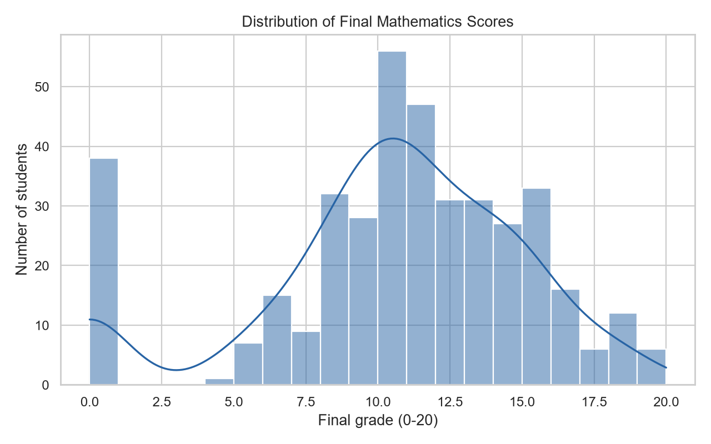
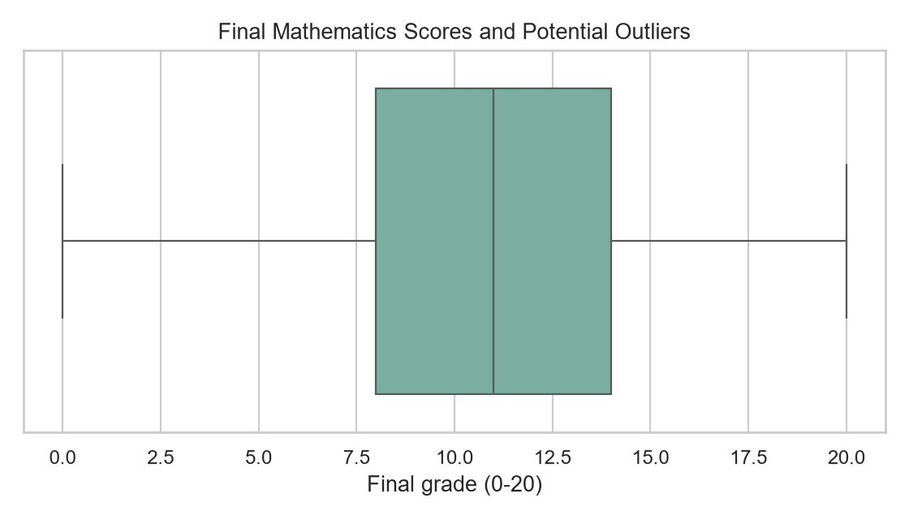
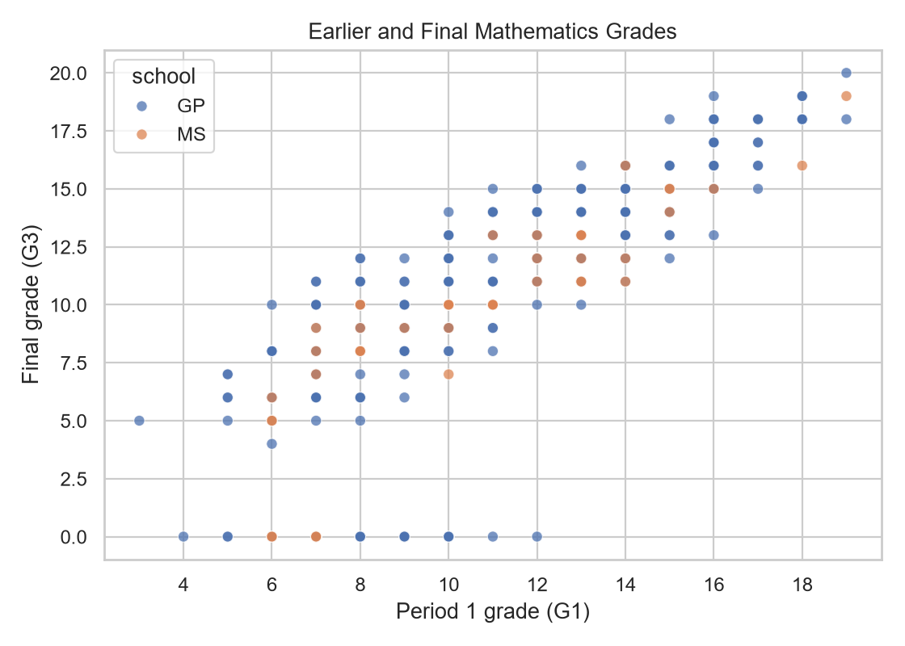
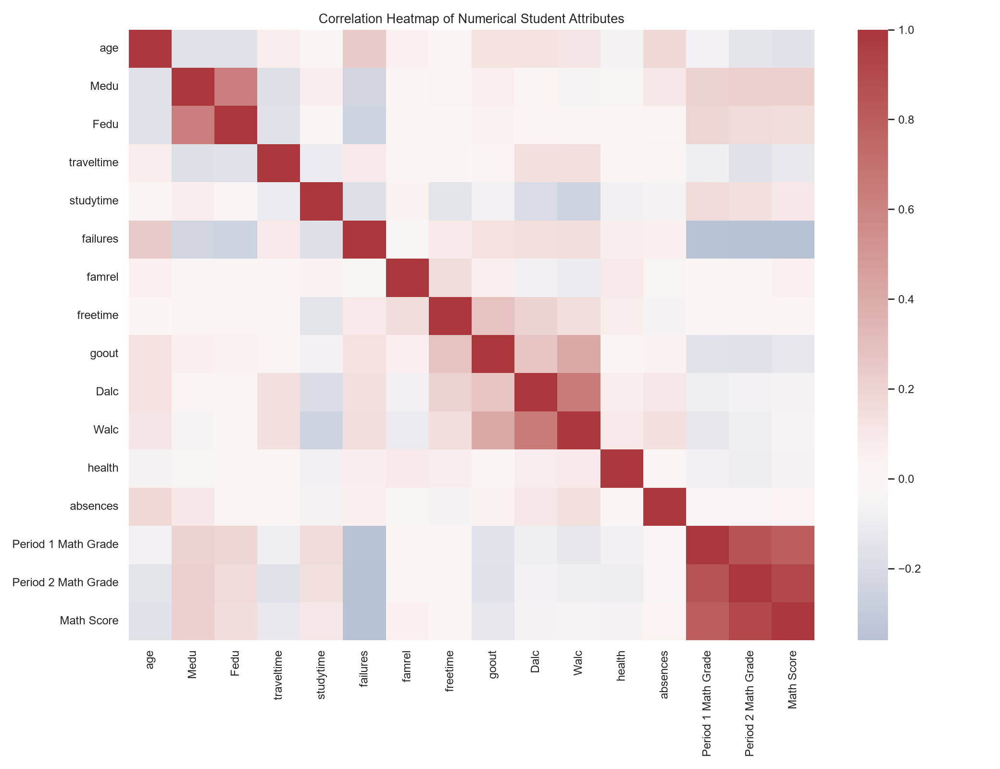
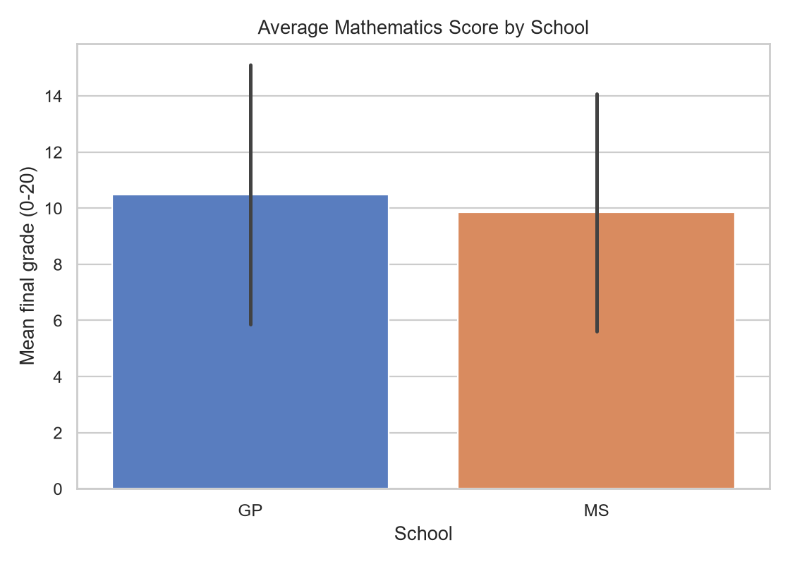
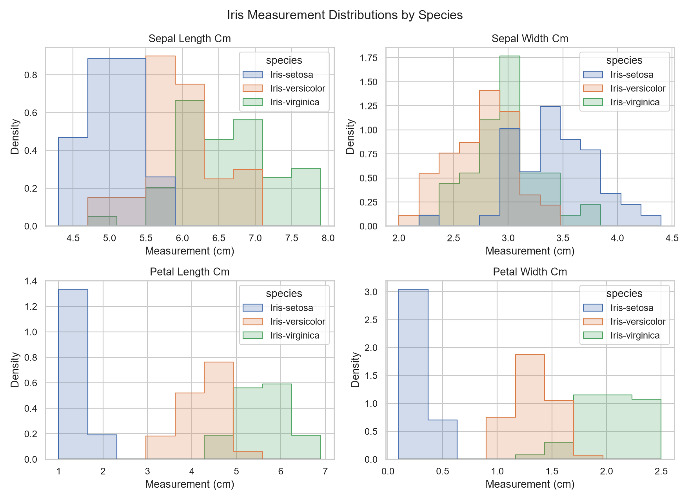
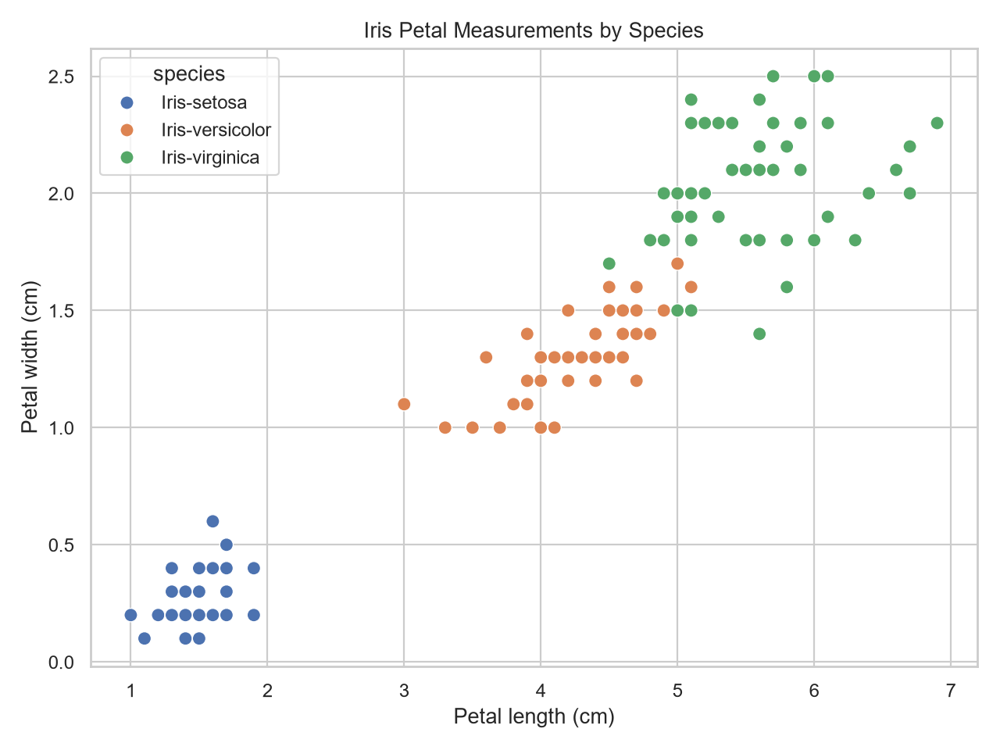
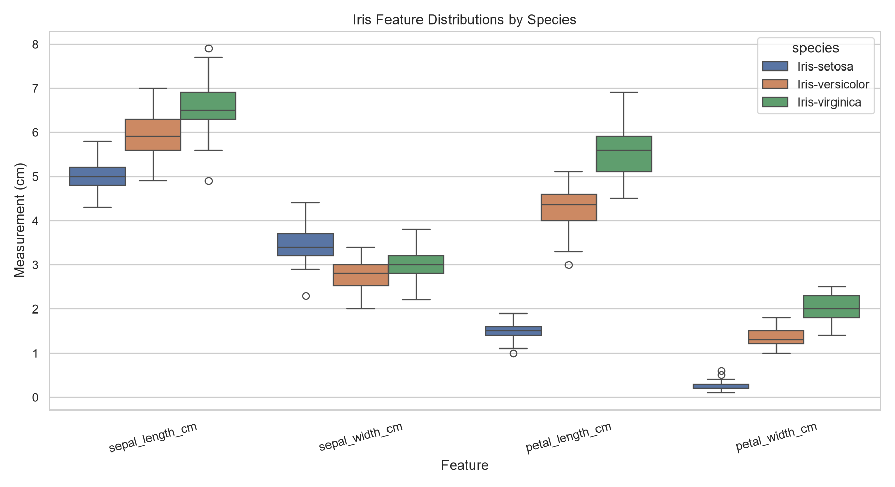
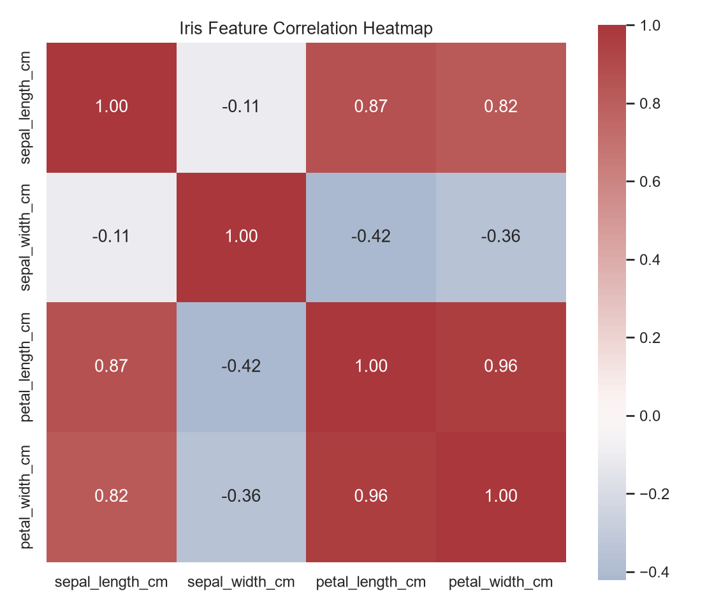

# Exploratory Data Analysis Report

**AI/ML Internship Task 1 — Student Performance Data Explorer and Iris Challenge**

## Project overview
This report documents reproducible exploratory analysis of two genuine public datasets. It summarizes data quality, cleaning, descriptive statistics, visual evidence, limitations, and source attribution. The scripts and notebooks regenerate the tables and figures.

## Datasets and sources

### Student Performance (mathematics)
The mathematics subset (`student-mat.csv`) comes from the [UCI Machine Learning Repository, Student Performance dataset 320](https://archive.ics.uci.edu/dataset/320/student). Its original delimiter is a semicolon. The source data covers secondary students at two Portuguese schools and includes demographic, school, family, social, absence, and period-grade fields. `G3` is renamed **Math Score** for analysis; `G1` and `G2` are labeled Period 1 and Period 2 Math Grade.

### Iris
The [UCI Iris dataset 53](https://archive.ics.uci.edu/dataset/53/iris), attributed to R. A. Fisher (1936), contains 150 flowers, four measurements in centimeters, and three species labels. The reusable CSV is stored at `data/iris.csv`.

## Data quality and cleaning

### Student data
The raw table has **395 rows and 33 columns**. It contains 0 missing cells and 0 exact duplicate rows before cleaning. The pipeline removed 0 duplicate rows and imputed 0 missing cells using numeric medians or categorical modes. After cleaning, 395 rows remain and 0 missing cells remain. The raw file is preserved; the cleaned table is saved separately as `student_data_cleaned.csv`.

### Iris data
The raw table has **150 rows and 5 columns**. It contains 0 missing cells and 3 exact duplicate rows. The cleaning function removed 3 duplicates and imputed 0 missing cells if present; the resulting table has 147 rows.

## Student mathematics results
The final grade is on a 0–20 scale. Mean: **10.42**; median: **11.00**; mode(s): **10**; minimum: **0**; maximum: **20**; sample standard deviation: **4.58**.

The Pearson correlation of Period 1 grade and final grade is **0.801**; Period 2 grade and final grade is **0.905**. These are associations in an observational dataset, not evidence that earlier grades cause later outcomes. The IQR rule flags **0** final grades as potential outliers; this statistical flag is not proof of erroneous data.

Average final grade by school: **GP** 10.49, **MS** 9.85. Group averages are descriptive; the schools may differ in many unmeasured ways.

### Student charts

*Figure 1. Distribution of final mathematics grades.*

*Figure 2. IQR display of potential score outliers.*

*Figure 3. Period 1 and final mathematics grades, colored by school.*

*Figure 4. Pearson correlations among numeric student attributes; correlation does not establish causation.*

*Figure 5. Mean final mathematics grade by school; error bars show standard deviation.*

## Iris results
There are 147 cleaned flowers, with species counts Iris-setosa: 48, Iris-versicolor: 50, Iris-virginica: 49. The feature means by species (cm) are:

| Species | Sepal length | Sepal width | Petal length | Petal width |
|---|---:|---:|---:|---:|
| Iris-setosa | 5.01 | 3.43 | 1.46 | 0.25 |
| Iris-versicolor | 5.94 | 2.77 | 4.26 | 1.33 |
| Iris-virginica | 6.60 | 2.98 | 5.56 | 2.03 |

Petal length and width vary substantially across species; the scatter plot separates setosa observations from the other groups, while versicolor and virginica overlap. This describes this small dataset only. Feature correlations summarize linear co-variation and are not causal.

### Iris charts

*Figure 6. Measurement distributions by species.*

*Figure 7. Petal measurements colored by species.*

*Figure 8. Measurement spread by species.*

*Figure 9. Pearson correlations among four Iris measurements.*

## Limitations
The student data is observational, represents two Portuguese schools, and is not a random sample of all students. Its grade history is strongly related to the final grade by design. Missing-value handling is included but should not be read as a claim that the source has missing values; actual counts are stated above. Outlier rules are exploratory. Iris has only 150 observations, balanced among three classes, and should not be generalized to all flower populations. Neither EDA supports causal conclusions.

## Conclusion
The project preserves the raw student file, provides a separately cleaned dataset, calculates reproducible summary statistics, and saves nine labeled charts. The notebooks and scripts make the inspection, cleaning, descriptive analysis, and visualization steps repeatable.

## References and attribution
1. Cortez, P. & Silva, A. (2008). Using data mining to predict secondary school student performance. UCI Machine Learning Repository, [Student Performance dataset](https://archive.ics.uci.edu/dataset/320/student).
2. Fisher, R. A. (1936). The use of multiple measurements in taxonomic problems. *Annals of Eugenics*, 7, 179–188. UCI Machine Learning Repository, [Iris dataset](https://archive.ics.uci.edu/dataset/53/iris), DOI: 10.24432/C56C76 (CC BY 4.0).
3. Statistical summaries are computed from the raw CSVs included in this project using pandas; chart styling uses Matplotlib and Seaborn.
